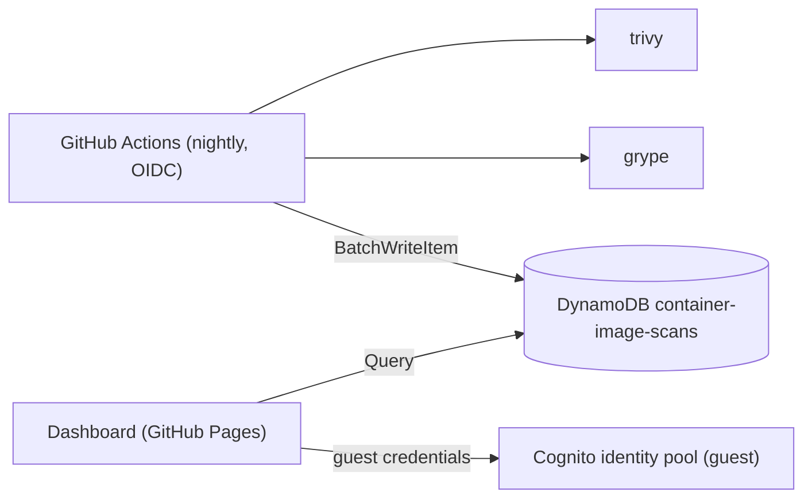

# Container Image Scans

Compare CVE findings across container images using
[trivy](https://trivy.dev/) and [grype](https://github.com/anchore/grype)
scanners. Results are stored in [Amazon DynamoDB](https://aws.amazon.com/dynamodb/)
and shown by a dashboard (Vite + Svelte) on GitHub Pages:
`https://ruzickap.github.io/container-image-scans/`.

## Table of Contents

- [Architecture](#architecture)
- [Container Images](#container-images)
- [Prerequisites](#prerequisites)
- [AWS Infrastructure](#aws-infrastructure)
- [Data Model](#data-model)
- [Local Development](#local-development)
- [GitHub Actions](#github-actions)
- [Project Structure](#project-structure)

## Architecture



There is no backend: the browser gets read-only guest credentials from
Cognito and queries DynamoDB directly. Everything stays in the AWS Always
Free tier.

## Container Images

`images.yml` is the source of truth: groups (language / purpose) with images
from different vendors. Only rolling tags (`latest`, `alpine`, `slim`, ...) are
used, so the list never pins an old version. The next scan picks up added or
changed images.

```yaml
php:
  description: PHP interpreter
  images:
    chainguard:                      # vendor - a column on the dashboard
      image: cgr.dev/chainguard/php:latest
      description: Chainguard Image on Wolfi OS - minimal, no shell
```

| Group  | Vendor      | Image                                           | Description                                                      |
|--------|-------------|-------------------------------------------------|------------------------------------------------------------------|
| python | docker      | `docker.io/python:alpine`                       | Docker Official Image on Alpine Linux (musl)                     |
| python | docker-slim | `docker.io/python:slim`                         | Docker Official Image on Debian (slim variant)                   |
| python | distroless  | `gcr.io/distroless/python3:latest`              | Google distroless on Debian - no shell, no package manager       |
| python | chainguard  | `cgr.dev/chainguard/python:latest`              | Chainguard Image on Wolfi OS - minimal, no shell                 |
| python | hummingbird | `quay.io/hummingbird/python:latest`             | Red Hat Hardened Image (Project Hummingbird) - distroless        |
| node   | docker      | `docker.io/node:alpine`                         | Docker Official Image on Alpine Linux (musl)                     |
| node   | docker-slim | `docker.io/node:slim`                           | Docker Official Image on Debian (slim variant)                   |
| node   | chainguard  | `cgr.dev/chainguard/node:latest`                | Chainguard Image on Wolfi OS - minimal, no shell                 |
| node   | hummingbird | `quay.io/hummingbird/nodejs:latest`             | Red Hat Hardened Image (Project Hummingbird) - distroless        |
| node   | suse        | `registry.suse.com/bci/nodejs:latest`           | SUSE Base Container Image (BCI) on SUSE Linux Enterprise         |
| php    | docker      | `docker.io/php:alpine`                          | Docker Official Image on Alpine Linux (musl), PHP CLI            |
| php    | chainguard  | `cgr.dev/chainguard/php:latest`                 | Chainguard Image on Wolfi OS - minimal, no shell                 |
| php    | hummingbird | `quay.io/hummingbird/php:latest`                | Red Hat Hardened Image (Project Hummingbird) - distroless        |
| php    | suse        | `registry.suse.com/bci/php:latest`              | SUSE Base Container Image (BCI) on SUSE Linux Enterprise         |
| nginx  | docker      | `docker.io/nginx:alpine`                        | Docker Official Image on Alpine Linux (mainline release)         |
| nginx  | chainguard  | `cgr.dev/chainguard/nginx:latest`               | Chainguard Image on Wolfi OS - minimal, no shell                 |
| nginx  | hummingbird | `quay.io/hummingbird/nginx:latest`              | Red Hat Hardened Image (Project Hummingbird) - distroless        |
| nginx  | suse        | `registry.suse.com/suse/nginx:latest`           | SUSE application image on SUSE Linux Enterprise                  |
| nginx  | ubuntu      | `docker.io/ubuntu/nginx:latest`                 | Canonical image on Ubuntu LTS                                    |
| ruby   | docker      | `docker.io/ruby:alpine`                         | Docker Official Image on Alpine Linux (musl)                     |
| ruby   | docker-slim | `docker.io/ruby:slim`                           | Docker Official Image on Debian (slim variant)                   |
| ruby   | chainguard  | `cgr.dev/chainguard/ruby:latest`                | Chainguard Image on Wolfi OS - minimal, no shell                 |
| ruby   | hummingbird | `quay.io/hummingbird/ruby:latest`               | Red Hat Hardened Image (Project Hummingbird) - distroless        |
| ruby   | suse        | `registry.suse.com/bci/ruby:latest`             | SUSE Base Container Image (BCI) on SUSE Linux Enterprise         |
| java   | temurin     | `docker.io/eclipse-temurin:latest`              | Eclipse Temurin JDK (Adoptium) - Docker Official Image on Ubuntu |
| java   | corretto    | `docker.io/amazoncorretto:latest`               | Amazon Corretto JDK - Amazon's OpenJDK build                     |
| java   | chainguard  | `cgr.dev/chainguard/jre:latest`                 | Chainguard JRE on Wolfi OS - minimal, no shell                   |
| java   | hummingbird | `quay.io/hummingbird/openjdk:latest`            | Red Hat Hardened Image (Project Hummingbird) - distroless        |
| java   | suse        | `registry.suse.com/bci/openjdk:latest`          | SUSE Base Container Image (BCI) on SUSE Linux Enterprise         |
| dotnet | microsoft   | `mcr.microsoft.com/dotnet/aspnet:latest`        | Microsoft official image on Debian                               |
| dotnet | chainguard  | `cgr.dev/chainguard/aspnet-runtime:latest`      | Chainguard Image on Wolfi OS - minimal, no shell                 |
| dotnet | hummingbird | `quay.io/hummingbird/aspnet-runtime:latest`     | Red Hat Hardened Image (Project Hummingbird) - distroless        |
| base   | alpine      | `docker.io/alpine:latest`                       | Alpine Linux - Docker Official Image (musl, BusyBox)             |
| base   | debian      | `docker.io/debian:stable-slim`                  | Debian stable - Docker Official Image (slim variant)             |
| base   | ubuntu      | `docker.io/ubuntu:latest`                       | Ubuntu LTS - Docker Official Image                               |
| base   | amazonlinux | `public.ecr.aws/amazonlinux/amazonlinux:latest` | Amazon Linux - official image from Amazon ECR Public             |
| base   | distroless  | `gcr.io/distroless/static:latest`               | Google distroless static - for static binaries, no libc          |
| base   | chainguard  | `cgr.dev/chainguard/static:latest`              | Chainguard static on Wolfi OS - for static binaries              |
| base   | hummingbird | `quay.io/hummingbird/core-runtime:latest`       | Red Hat Hardened Image (Project Hummingbird) - minimal runtime   |

Keep this table in sync with `images.yml`.

## Prerequisites

- [mise](https://mise.jdx.dev/) (`curl https://mise.run | sh`) - manages
  Bun, grype, trivy, and [uv](https://docs.astral.sh/uv/) via `mise.toml`.
  uv installs Python (`.python-version`) and the scanner dependencies
  (`uv.lock`). Run `mise install` after cloning
- [Docker](https://www.docker.com/) (for running scans locally)

## AWS Infrastructure

The DynamoDB table, the Cognito identity pool, the IAM roles, and the
alerts are managed by OpenTofu in
[`ruzickap/my-git-projects/opentofu/aws`](https://github.com/ruzickap/my-git-projects/tree/main/opentofu/aws)
(account `my-aws`, region `eu-central-1`). This repository only uses them:

| Resource                                             | Used by                                             |
|------------------------------------------------------|-----------------------------------------------------|
| DynamoDB table `container-image-scans`               | `scripts/scan_and_upload.py` (write), `web/` (read) |
| Cognito identity pool                                | `web/` - guest `GetItem` / `BatchGetItem` / `Query` |
| IAM role `GitHubOidc-ruzickap-container-image-scans` | GitHub Actions (OIDC) - write to the table          |

The role ARN is stored as the `CONTAINER_IMAGE_SCANS_AWS_ROLE_TO_ASSUME`
Actions secret. The identity pool ID, region, and table name are public and
set in `web/src/lib/dynamodb.ts`.

The table has only 2 RCU / 25 WCU (free tier): writes are throttled and
retried, the dashboard reads only small partitions (no `Scan`).

## Data Model

One table, partition key `pk`, sort key `sk` (both strings). Every item
has `expires_at` (epoch seconds) - DynamoDB TTL deletes it two years after
the scan.

| Item        | `pk`                                           | `sk`                         | Attributes                                                                                                                                                                                                                  |
|-------------|------------------------------------------------|------------------------------|-----------------------------------------------------------------------------------------------------------------------------------------------------------------------------------------------------------------------------|
| Latest scan | `LATEST`                                       | `<group>#<vendor>#<scanner>` | `group`, `group_description`, `vendor`, `image`, `image_description`, `scanner`, `scanner_version`, `scanner_db`, `image_digest`, `scanned_at`, `cves_pk`, `cve_total`, `cve_critical`, `cve_high`, `cve_medium`, `cve_low` |
| CVE         | `CVES#<group>#<vendor>#<scanner>#<scanned_at>` | `<CVE ID>#<package>`         | `cve_id`, `severity`, `description`, `url`, `package_name`, `installed_version`, `fixed_version`                                                                                                                            |

- The dashboard queries `pk = LATEST` for the overview and `pk = cves_pk`
  for the CVEs of one scan
- Each scan writes its CVEs to a new partition first and then overwrites
  its `LATEST` item, so the dashboard never shows a half-written scan
- `LATEST` is keyed by group and vendor, not by the image name - a new
  image of the same vendor replaces the old row. Removed groups / vendors
  stay until the TTL deletes them
- Severity, package, and versions are the scanner's own values (from its
  JSON report: `trivy --format json`, `grype --by-cve -o json`), one entry
  per CVE and package - so trivy and grype counts are comparable
- A failed pull, scanner run, or upload is skipped - the dashboard keeps
  the previous result. The other images are still scanned, the run fails
  at the end
- The vulnerability databases are updated once per run - all scans use
  them (no per-scan update), trivy scans only for vulnerabilities (no
  secret scanning)
- The full scanner reports are not stored (DynamoDB items are limited to
  400 KB)

## Local Development

### Running a scan locally

Scan all images and print a CVE summary (no AWS needed):

```bash
mise run scan
```

Scan and upload the results to DynamoDB (needs AWS credentials allowed to
write to the table, e.g. the `my-aws` profile):

```bash
AWS_PROFILE=my-aws mise run scan:upload
```

The scanner is the Python script `scripts/scan_and_upload.py` (run by
uv). It also reads `AWS_REGION` (default `eu-central-1`), `DYNAMODB_TABLE`
(default `container-image-scans`), and `IMAGES_FILE` (default
`images.yml`). Its tests need no Docker, scanners, or AWS:

```bash
mise run scan:test # pytest
```

### Dashboard

`web/` is a [Vite](https://vite.dev/) + [Svelte](https://svelte.dev/)
TypeScript app, installed, tested, and built with [Bun](https://bun.com/)
(`web/bunfig.toml` runs the scripts on the Bun runtime). The build bundles
the AWS SDK and produces static files in `web/dist/`, published to GitHub
Pages.

```bash
mise run web:dev   # dev server with hot reload, reads the real DynamoDB table
mise run web:test  # Vitest + Svelte Testing Library, no AWS access needed
mise run web:build # svelte-check + tsc, then build to web/dist/
```

To use [DynamoDB Local](https://docs.aws.amazon.com/amazondynamodb/latest/developerguide/DynamoDBLocal.html)
instead of AWS, set `VITE_DYNAMODB_ENDPOINT=http://localhost:8000` for
`bun run dev` / `bun run build` in `web/` (Cognito still issues the guest
credentials, DynamoDB Local accepts any).

### Available mise tasks

| Task          | Description                                        |
|---------------|----------------------------------------------------|
| `scan`        | Scan all container images, print CVE summary       |
| `scan:upload` | Scan all images and upload results to DynamoDB     |
| `scan:test`   | Run the scanner tests (pytest)                     |
| `web:install` | Install the dashboard dependencies (`bun install`) |
| `web:dev`     | Start the dashboard dev server with hot reload     |
| `web:check`   | Type-check the dashboard (`svelte-check` + `tsc`)  |
| `web:test`    | Run the dashboard tests (Vitest)                   |
| `web:build`   | Type-check and build the dashboard to `web/dist/`  |

## GitHub Actions

### Core workflows

#### Nightly Scans (`.github/workflows/nightly-scans.yml`)

- **Schedule**: every day at 00:00 UTC (or manual)
- Assumes the AWS role via OIDC (`CONTAINER_IMAGE_SCANS_AWS_ROLE_TO_ASSUME`),
  the credentials are valid 1 hour - so the run is limited to 1 hour
  (`timeout-minutes: 60`). Images not scanned in time keep their previous
  results
- Installs trivy, grype, and uv via mise (uv installs Python and the
  scanner dependencies)
- Pulls each image, scans it with both scanners, writes the results to
  DynamoDB (`mise run scan:upload`), and removes the image to free the
  runner disk (CI only)

#### Scanner Tests (`.github/workflows/scanner-tests.yml`)

- **Trigger**: push to any branch except `main` touching the scanner
  (`scripts/**`, `tests/**`, `pyproject.toml`, `uv.lock`), `images.yml`,
  or `mise.toml`, or manual
- Runs the scanner tests (`mise run scan:test`). Not a required check - do
  not merge a red run

#### Deploy Web (`.github/workflows/deploy-web.yml`)

- **Trigger**: push to `main` touching `web/**` or `mise.toml`, or manual
- Installs Bun via mise, type-checks and builds the dashboard
  (`mise run web:build`), and publishes `web/dist/` to the `gh-pages`
  branch (GitHub Pages). The tests already ran on the branch (Web Tests)

#### Web Tests (`.github/workflows/web-tests.yml`)

- **Trigger**: push to any branch except `main` touching `web/**` or
  `mise.toml` (pull request and Renovate branches), or manual. Not a
  required check - do not merge a red run
- Runs the tests (`mise run web:test`), the type check and the build
  (`mise run web:build`)

### CI / quality workflows

| Workflow        | File               | Trigger                     |
|-----------------|--------------------|-----------------------------|
| MegaLinter      | `mega-linter.yml`  | Push to non-main branches   |
| CodeQL          | `codeql.yml`       | Push to `main`, PRs, weekly |
| OSSF Scorecards | `scorecards.yml`   | Push to `main`, weekly      |
| Commit Check    | `commit-check.yml` | PRs to `main`               |

### Automation workflows

| Workflow              | File                        | Trigger                         |
|-----------------------|-----------------------------|---------------------------------|
| Release Please        | `release-please.yml`        | Push to `main`                  |
| Stale Issues/PRs      | `stale.yml`                 | Daily                           |
| PR Size Labeler       | `pr-size-labeler.yml`       | Pull requests                   |
| PR Slack Notification | `pr-slack-notification.yml` | PR events (open, review, close) |

## Project Structure

```text
container-image-scans/
+-- .github/
|   +-- workflows/
|       +-- codeql.yml                # CodeQL security analysis
|       +-- commit-check.yml          # Commit message validation
|       +-- deploy-web.yml            # Deploy dashboard to GH Pages
|       +-- mega-linter.yml           # Comprehensive linting + security
|       +-- nightly-scans.yml         # Nightly trivy + grype scans
|       +-- pr-size-labeler.yml       # Auto-label PRs by size
|       +-- pr-slack-notification.yml # Slack notifications for PRs
|       +-- release-please.yml        # Automated releases
|       +-- scorecards.yml            # OSSF Scorecard analysis
|       +-- stale.yml                 # Close stale issues/PRs
|       +-- scanner-tests.yml         # Test the scanner on push
|       +-- web-tests.yml             # Test + build the dashboard on push
+-- scripts/
|   +-- scan_and_upload.py            # Scan images & upload to DynamoDB
+-- tests/
|   +-- test_scan_and_upload.py       # Scanner tests (fake scanners / table)
+-- web/                              # Dashboard (Vite + Svelte, GitHub Pages)
|   +-- src/
|   |   +-- lib/dynamodb.ts           # Cognito guest + DynamoDB queries, types
|   |   +-- lib/dynamodb.test.ts      # Tests: paged Query (fake AWS client)
|   |   +-- App.svelte                # Overview table + CVE list
|   |   +-- App.test.ts               # Tests: rendering, sorting, clicks, safety
|   |   +-- app.css                   # Global styles
|   |   +-- main.ts                   # Mounts the app
|   |   +-- test-setup.ts             # Vitest setup (DOM matchers)
|   +-- index.html                    # Vite entry page
|   +-- bun.lock                      # Locked dependency versions (Bun)
|   +-- bunfig.toml                   # Bun config: scripts run on Bun, not Node.js
|   +-- package.json                  # Dependencies + scripts
|   +-- svelte.config.js
|   +-- tsconfig*.json
|   +-- vite.config.ts                # Vite + Vitest configuration
+-- .checkov.yml                      # Checkov skip-check config
+-- .gitignore
+-- .mega-linter.yml                  # MegaLinter configuration
+-- .rumdl.toml                       # rumdl markdown linter config
+-- AGENTS.md                         # AI agent coding guidelines
+-- images.yml                        # Container images to scan
+-- LICENSE
+-- lychee.toml                       # Link checker configuration
+-- mise.toml                         # mise tool versions + tasks
+-- pyproject.toml                    # Scanner dependencies + linter config
+-- .python-version                   # Python version for uv
+-- README.md
+-- SECURITY.md                       # Security policy
+-- uv.lock                           # Locked scanner dependency versions
```
